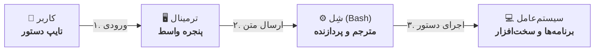

# فصل ۱ — CLI چیست و چرا دولوپرها عاشقش‌ان؟

> 🎯 **هدف این فصل:** مفهوم‌های بنیادی رو مرتب کنی: ترمینال چیست، شل چیست، فرقشون چیه، و چرا صنعت نرم‌افزار هنوز بعد از ۵۰ سال به این «سیاه‌صفحه» وابسته‌ست. هنوز هیچ دستوری نمی‌زنیم — فقط ذهنیت.

---

## ۱.۱ — سه کلمه‌ای که قاطی می‌شن: Console، Terminal، Shell

| واژه | چیه | شبیه به |
|---|---|---|
| **Shell** | برنامه‌ای که دستورات متنی رو *می‌فهمه و اجرا می‌کنه* (Bash، PowerShell، Zsh) | مغز — مترجم تو با سیستم‌عامل |
| **Terminal** | پنجره‌ای که شل رو *نگه می‌داره و نمایش می‌ده* (Windows Terminal، iTerm، ترمینال VS Code) | بدن — پنجره و صفحه‌کلید |
| **Console** | تاریخچه‌ای: صفحه‌کلید+نمایشگر فیزیکی رایانه‌های قدیمی | امروزه معمولاً = terminal |

رابطه‌شون:


> 🔄 **مسیر بازگشت خروجی:** سیستم‌عامل نتیجه پردازش را به **شِل** برمی‌گرداند ➔ شِل متن خروجی را به **ترمینال** می‌سپارد ➔ ترمینال آن را روی صفحه به **کاربر** نمایش می‌دهد.

پس وقتی می‌گیم «ترمینال باز کن»، عملاً یعنی «یک پنجره باز کن که داخلش Bash اجرا شده باشه». 

### شل‌های اصلی که خواهی دید

| شل | کجا | نکته |
|---|---|---|
| **Bash** | لینوکس، مک، Git Bash ویندوز | ⭐ استاندارد جهانی — محور این دوره |
| Zsh | مک (پیش‌فرض جدید) + oh-my-zsh | تقریباً سازگار با Bash |
| PowerShell | ویندوز | سبک متفاوت: cmdlet ها مثل `Get-ChildItem` |
| cmd | ویندوز قدیمی | `dir` به جای `ls` — میراث DOS |

> 💡 **چرا Bash یاد بگیریم و نه PowerShell؟** چون هر سرور لینوکسی روی زمین، هر آموزش گیت/داکر/Node و هر شرکت لینوکس‌محور با Bash صحبت می‌کنه. PowerShell فقط در محیط ویندوز-محوره. Bash یاد بگیری، همه‌جا مسلطی؛ cmd یاد بگیری، فقط تو یه گوشه‌ی ویندوز کارت راهه.

---

## ۱.۲ — چرا رابط متنی، وقتی گرافیکی داریم؟

سوال منصفانه‌ست. جواب در سه کلمه: **قابلیت ترکیب، خودکارسازی، سرعت.**

**۱) قابلیت ترکیب (Composition):** در GUI هر ابزار جزیره‌ایه. در CLI همه ابزارها با یک استاندارد مشترک (متن) حرف می‌زنن — پس زنجیر می‌شن:

```bash
cat error.log | grep "ERROR" | sort | uniq -c | sort -rn
# بخون لاگ رو، فقط خطاهای ERROR رو بردار، مرتب کن، بشمار، پربسامدها اول
```

یک خط، کار یک ابزار تحلیلی کرد. در GUI برای این کار چند نرم‌افزار و کلی کپی/پیست لازم بود.

**۲) خودکارسازی:** هر چیزی که دستی تایپ می‌شه، می‌شه توی یک فایل اسکریپت گذاشت و هزار بار اجراش کرد. دکمه‌ی GUI رو نمی‌تونی «ذخیره و تکرار» کنی؛ دستور CLI رو می‌تونی.

**۳) سرعت و دقت:** برای کارهای تکراری (ساخت پروژه، پیمایش بین دوتا پوشه دور، نصب ابزار) تایپ چند حرف از سوییچ‌دار بودن دست‌هات سریع‌تر از حرکت موسه.

**۴) و مهم‌ترین برای تو — کل اکوسیستم دولوپری CLI-محوره:** `git`، `npm`، `npx create-next-app`، `psql`، `ssh`، `docker`، `gh` — همه فقط کامند لاین دارن (یا GUI هاشون ناقصه). دولوپر بدون CLI مثل آشپز بدون چاقوئه.

> 🔑 **چشم‌انداز دوره:** قرار نیست «حافظه‌ت رو با صدها دستور پر کنی». قراره *روش فکر کردن* به CLI رو یاد بگیری: هر ابزار یک کار کوچیک رو عالی انجام می‌ده، و تو اونها رو مثل لگو کنار هم می‌چینی. حافظه رو به Tab و --help می‌سپاریم (فصل ۳ و ۵).

---

## ۱.۳ — یک نگاه به آینده: شکل یک دستور

تمام دستوراتی که یاد می‌گیری یک الگوی مشترک دارن — حالا که می‌بینی، بقیه دوره فقط پر کردن جدوله:

```
command  -short-flag  --long-flag  argument  argument
   │          │             │           │
   │          │             │           └── روی «چه چیزی» اجرا شه (اسم فایل، مسیر...)
   │          │             └── گزینه بلند (کامل و خوانا)
   │          └── گزینه کوتاه (حرف‌خلاصه)
   └── اسم برنامه
```

مثال واقعی که تا حالا دیدی:

```bash
git commit -m "پیام"      # برنامه=git، فلگ=-m، آرگومان="پیام"
npx create-next-app my-app --typescript
```

و دو قاعده جهانی که از همین الان بدونی:

1. **حساس به بزرگی/کوچکی حروفه** — `ls` کار می‌کنه، `LS` نه
2. **فلگ‌ها اختیاری‌ان، ترتیب آرگومان‌ها مهمه** — `git -m commit` غلطه

---

## ۱.۴ — افسانه‌های ترسناک (و حقیقتشون)

| افسانه 😱 | حقیقت ✅ |
|---|---|
| «اگه اشتباه بزنم سیستم می‌سوزه» | شل دستور ناقص رو اصلاً اجرا نمی‌کنه؛ فقط ارور می‌ده. حتی حذف فایل‌ها هم محدوده به همون مسیری که درشی |
| «باید صدها دستور حفظ باشم» | ۲۰-۳۰ دستور ۹۵٪ کار روزمره‌ست؛ بقیه با --help |
| «ترمینال برای هکرهاست» | ترمینال برای *هر کسی که کارش خودکارسازیه* — یعنی هر دولوپر |
| «ویندوز CLI نداره» | Git Bash یک Bash واقعی رو روی ویندوزت داری؛ و Windows Terminal همه رو یک‌جا جمع می‌کنه |

> ⚠️ فقط یک استثنای واقعی برای «ترس»: دستورهای تخریبی با مسیر اشتباه (`rm -rf` روی مسیر غلط) خطرناکن — مثل هر ابزار قدرتمند دیگه. قانون‌های ایمنی رو در فصل ۴ می‌سازیم و بعد دیگه نگرانی معنا نداره.

---

## ۱.۵ — جایگاه CLI در اکوسیستم و نقشه راه برنامه‌نویسی

ابزارهای استاندارد دنیای مهندسی نرم‌افزار و کاربرد هر یک در سرفصل‌های این دوره:

| ابزار | کاربرد در پروژه‌های واقعی | فصل مربوط |
|---|---|---|
| `git` / `npx` | مدیریت نسخه و اجرای پکیج‌های توسعه | ۱۱ |
| `psql` | ارتباط و کوئری‌زدن به دیتابیس در ترمینال | ۶ (ورودی/خروجی) |
| `ssh-keygen` | تولید کلیدهای امنیتی برای سرورها و مخازن کد | ۸، ۱۱ |
| `npm run dev` | اجرای سرورهای توسعه و پروسه‌های وب | ۱۰ (پروسه‌ها) |
| `.env` | مدیریت متغیرهای محیطی و کلیدهای پیکربندی | ۹ |

خط فرمان در واقع زبان مشترک و زیرساخت ارتباطی میان تمام این ابزارهاست و تسلط بر آن موجب درک عمیق‌تر سازوکار نرم‌افزارها می‌شود.

---

## ✅ جمع‌بندی فصل

- **Shell** = مترجم دستورات (Bash ⭐)، **Terminal** = پنجره‌ی نگه‌دارنده‌اش
- CLI سه مزیت دارد: ترکیب‌پذیری (پایپ‌ها)، خودکارسازی (اسکریپت)، سرعت
- الگوی همه دستورات: `command -flag --long-flag argument`
- حساس به حروف؛ فلگ اختیاری؛ ترتیب آرگومان مهم
- ترس‌ها افسانه‌ان؛ فقط تخریب با مسیر غلط واقعیه → قانون ایمنی در فصل ۴
- Bash یاد بگیری = همه‌جا (لینوکس، مک، ویندوز، سرورها) مسلطی

## 📝 تمرین فصل ۱

1. با جمله خودت فرق shell و terminal رو بگو (یک جمله کافیه).
2. سه دستور رایج ابزارهای توسعه (مانند git یا npm) را با الگوی `command + flag + argument` باز کن. (مثال: `npm install -g pnpm` → برنامه npm، فلگ -g، آرگومان install و pnpm)
3. سوال فکری: چرا `git -m commit` غلطه ولی `git commit -m "x"` درسته؟ (راهنمایی: چیه git از مال خودشه؟)

<details><summary>جواب‌ها</summary>

1. شل برنامه‌ای است که دستور را تفسیر و اجرا می‌کند؛ ترمینال پنجره‌ای است که شل داخلش اجرا و نمایش داده می‌شود.
3. چون ترتیب آرگومان‌ها مهم است: اول برنامه (git)، بعد زیردستور (commit)، بعد فلگ‌ها و آرگومان‌های خودِ آن زیردستور. زیردستور کامیت است که با -m کار می‌کند، نه خود git.
</details>

➡️ **فصل بعد:** ترمینالت رو مثل حرفه‌ای‌ها آماده می‌کنیم و اولین Enter رو می‌زنیم!
