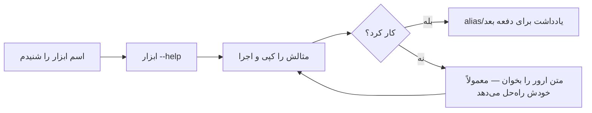

# فصل ۵ — راهنما گرفتن از خود سیستم: هرگز چیزی حفظ نکن

> 🎯 **هدف:** یاد بگیری هر دستوری — حتی اونی که تا حالا اسمش رو نشنیدی — رو بدون گوگلِ اجباری خودت کشف کنی: --help، man، which، alias و فایل پیکربندی شل. این فصل = «ویژه‌ی فراموش‌کارها» (یعنی همه‌ی ما).

---

## ۵.۱ — سه سطح راهنما

```bash
$ mkdir --help          # ۱) راهنمای سریع: فلگ‌ها + یک خط توضیح هرکدوم
$ man mkdir             # ۲) کتابچه کامل (manual) — فقط لینوکس/مک؛ در Git Bash غالباً نیست
$ which node            # ۳) این دستور کجای سیستم نصبه؟
```

`--help` (یا گاهی `-h`) تقریباً روی *هر* ابزار مدرنی کار می‌کنه — git، npm، node، psql. عادت کن: **قبل از سرچ کردن، اول `ابزار --help` بزن.** نصف سوال‌هات همون‌جا جواب داره.

نمونه خروجی (بریده‌ای از `ls --help`):

```
Usage: ls [OPTION]... [FILE]...
  -a, --all          do not ignore entries starting with .
  -l                 use a long listing format
  -h, --human-readable  with -l, print sizes in human readable format
```

الگوی خوندنش: `Usage` می‌گه «چطور صدا زده می‌شه» (چیزی که توی `[ ]` است اختیاریه)، بعد فلگ‌ها با نسخه کوتاه/بلندشون.

## ۵.۲ — `which` و `type`: این دستور از کجا میاد؟

وقتی `node` رو اجرا می‌کنی، شل در یک لیست مسیرها (PATH — فصل ۹) دنبال فایل اجرایی‌اش می‌گرده. ببین کجا پیداش کرده:

```bash
$ which node
/c/Program Files/nodejs/node

$ which git
/c/Program Files/Git/cmd/git

$ type cd          # برای دستورهای داخلی شل (which نمی‌بیندشان)
cd is a shell builtin
```

کاربرد عملی: «چرا X کار نمی‌کنه؟» — اول `which X`. جواب خالی یعنی اصلاً نصب نیست یا تو PATH نیست (فصل ۹ دقیقاً همینو حل می‌کنه). جواب مسیر عجیب یعنی نسخه اشتباهی اجرا می‌شه!

## ۵.۳ — alias: اسم مستعار برای دستورهای بلند

```bash
$ alias cls='clear'                    # از این به بعد cls = clear
$ alias ll='ls -lah'                   # محبوب‌ترین alias دنیا
$ cls                                  # ✅ کار می‌کند
```

⚠️ مشکل: alias ای که توی ترمینال تعریف کردی، با بستن ترمینال می‌پره. راه دائمی: نوشتنش در **فایل پیکربندی شل**:

```bash
$ nano ~/.bashrc        # فایل پیکربندی هر بارِ اجرای Bash (nano = ادیتور متنی ساده ترمینال)
```

این خطوط رو اضافه کن، با Ctrl+O ذخیره و Ctrl+X خارج شو:

```bash
alias ll='ls -lah'
alias cls='clear'
alias gs='git status -sb'        # وضعیت خلاصه و تمیز گیت
alias serve='npx serve .'        # سرور استاتیک فوری
```

برای اعمال بدون ری‌استارت ترمینال:

```bash
$ source ~/.bashrc
```

> 💡 `~/.bashrc` = فایلی که هر بار شل بالا میاد اول اون رو اجرا می‌کنه — جای alias ها، رنگ‌ها و تنظیمات شخصیه. مثل `index.js` که اول برنامه اجرا می‌شه، برای شل.

## ۵.۴ — راهنمای زنده: پیشنهاد خودکار

دو کمکی که Git Bash/ترمینال‌های مدرن خودکار می‌دن:

- **Tab روی فلگ‌ها:** `git comm<Tab>` کامل می‌کنه؛ حتی `git commit --<Tab><Tab>` لیست فلگ‌ها رو نشون می‌ده (اگه تکمیل گیت نصب باشه)
- **پیام «did you mean»:** `git commit` با غلط املایی → گیت خودش پیشنهاد می‌ده. خجالت نداره، همه دیر یا زود می‌بینیمش 😄

## ۵.۵ — استراتژی «حافظه بیرونی»

چرخه‌ای که حرفه‌ای‌ها با هر ابزار جدید انجام می‌دن:



حتی خود گیت این فلسفه رو داره:

```bash
$ git help commit      # کتابچه کامل زیردستور commit
$ git commit --help    # همان، در مرورگر/ادیتور
```

---

## ✅ جمع‌بندی فصل

- `ابزار --help` = اولین قدم همیشه؛ `man` کتابچه کامل (لینوکس/مک)
- `which` می‌گه فایل اجرایی از کجا اجرا می‌شه — ابزار اولیه دیباگِ «کار نمی‌کنه»
- `alias` برای خلاصه‌سازی؛ دائمی‌اش فقط در `~/.bashrc` + `source` برای اعمال فوری
- `nano` ساده‌ترین ادیتور ترمینال: Ctrl+O ذخیره، Ctrl+X خروج
- حرفه‌ای = حفظ نکردن؛ چرخه‌ی help → اجرا → alias

## 📝 تمرین فصل ۵

1. `node --help` و `npm --help` رو بزن — فلگ `-v` (نمایش نسخه) رو توشون پیدا کن.
2. `which` رو بزن برای: `node`، `git`، `npm`، `psql` (یا هر ابزار دیتابیس دیگری که نصب داری). کدوم مسیرها عجیب‌ان؟
3. سه alias به `~/.bashrc` اضافه کن: `ll`، `gs` (status خلاصه گیت)، `serve`. با `source` فعالشون کن و `ll` رو تست کن.
4. با nano یک فایل `about.txt` بساز، چند خط بنویس، ذخیره کن و با `cat` بخونش.

<details><summary>نکته تمرین ۲</summary>

اگر `which psql` خالی برگشت ولی PostgreSQL رو نصب کردی، یعنی مسیر `C:\Program Files\PostgreSQL\18\bin` به PATH ویندوز اضافه نشده — دقیقاً همون موضوع فصل ۹! یادداشتش کن.
</details>

➡️ **فصل بعد:** ابرقدرت واقعی شل — اتصال دستورها به هم با pipes و ذخیره خروجی‌ها با redirection.
