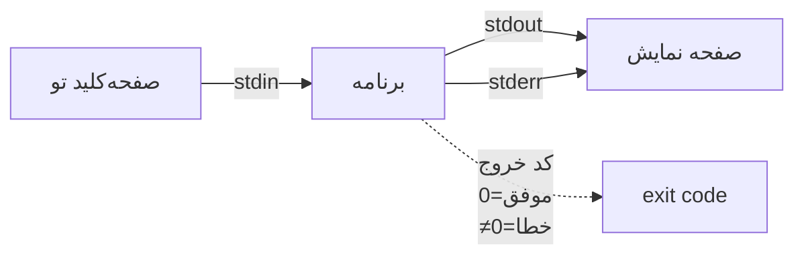

# فصل ۶ — Pipes و Redirection: ابرقدرت شل ⭐

> 🎯 **هدف:** مهم‌ترین مفهوم فلسفی شل: هر برنامه یک فیلتره و خروجی هر برنامه می‌شه ورودی برنامه بعدی. با `|` و `>` و `>>` و `<` یاد می‌گیری دستورها رو مثل لگو به هم وصل کنی — همون چیزی که در فصل ۱ قولش رو داده بودیم.

---

## ۶.۱ — سه جریان: stdin، stdout، stderr

هر برنامه‌ی ترمینالی سه «لوله» داره:



| جریان | شماره | چیه |
|---|---|---|
| stdin | 0 | ورودی — معمولاً صفحه‌کلید |
| stdout | 1 | خروجی عادی |
| stderr | 2 | پیام‌های خطا |

خبر خوب: چون همه‌چیز *متن* است، این لوله‌ها رو می‌تونی بچرخونی و به جای صفحه نمایش، به یک برنامه دیگه یا یک فایل وصل کنی. همینه که `console.log` با نوشتن در فایل فرق داره — اینجا **جریان** قابل اتصاله.

## ۶.۲ — Redirection: خروجی رو بفرست جای دیگه

```bash
$ echo "خط اول" > notes.txt        # بنویس در فایل (بازنویسی!)
$ echo "خط دوم" >> notes.txt       # اضافه کن به انتهای فایل (append)
$ cat notes.txt                     # بخون تا مطمئن شی
خط اول
خط دوم
```

⚠️ تفاوت خطرناک `>` و `>>`: تک‌شِورون (`>`) فایل موجود رو **صفر می‌کنه**. (و راه حافظه‌ای: هرچی شِورون بیشتر، محتاط‌تر.)

ورودی هم می‌شه از فایل گرفت:

```bash
$ wc -l < notes.txt        # چند خط دارد؟ (ورودی از فایل)
2
```

و یک ترفند که مهندس‌ها عاشقشن: خالی کردن فایل به سرعت:

```bash
$ > big.log        # فایل را خالی کن (به سایز صفر)
```

## ۶.۳ — Pipe `|`: خروجی → ورودی برنامه بعدی

قوی‌ترین کاراکتر شل:

```bash
$ cat orders.txt | sort | uniq -c | sort -rn
```


هر مرحله یک فیلتر ساده؛ زنجیره = یک ابزار تحلیل داده. با داده نمونه امتحانش کن:

```bash
$ printf "ali\nsara\nali\nreza\nsara\nali\n" | sort | uniq -c | sort -rn
  3 ali
  2 sara
  1 reza
```

چهار دستور، خروجی «رتبه‌بندی خریداران» — کوچک‌ترین داشبورد دنیا 😄

## ۶.۴ — ابزارهای فیلتر پایه (همتای زنجیره‌ها)

| ابزار | کار | مثال |
|---|---|---|
| `wc` | شمارش (l=خط، w=کلمه، c=بایت) | `wc -l file` چند خط؟ |
| `sort` | مرتب‌سازی (r=نزولی، n=عددی) | `sort names.txt` |
| `uniq` | فشرده‌سازی خطوط تکراری *مجاور* (همیشه با sort) | `sort f \| uniq -c` |
| `head` / `tail` | برش اول/آخر | `... \| head -5` فقط ۵ تای اول |
| `tee` | نمایش + ذخیره همزمان | `npm run build \| tee build.log` |

## ۶.۵ — stderr رو هم کنترل کن (سطح ۲)

خطاها به فایل نمی‌رن چون به stdout وصل نیستن! برای کنترل هر سه جریان:

```bash
$ npm run build > out.log            # فقط stdout ذخیره می‌شود
$ npm run build > out.log 2> err.log # خطاها جدا
$ npm run build > all.log 2>&1       # هر دو، با هم در یک فایل ⭐
$ npm run build > /dev/null 2>&1     # همه را دور بریز (dev/null = سیاه‌چاله)
```

> 💡 چرا مهمه؟ چون «لاگ بیلدم چرا فایلم خالیه؟» یکی از رایج‌ترین گیج‌شدگی‌های دولوپرهاست — جواب: خطاها در stderr بودن!

## ۶.۶ — سناریوهای واقعی دولوپر (اینها رو حفظ کن، هر هفته لازم می‌شن)

```bash
# ۱) لاگ بیلد بلنده — فقط خطاها:
$ npm run build 2>&1 | grep -i "error" | head -20

# ۲) چند فایل در این پروژه import شده از ماژول x؟
$ grep -r "from 'axios'" src/ | wc -l

# ۳) خروجی تست رو هم ببین هم ذخیره کن:
$ npm test 2>&1 | tee test-result.log

# ۴) بزرگ‌ترین پوشه‌ها/فایل‌های پروژه (دیسک چرا پر شد؟):
$ du -sh * | sort -rh | head -10

# ۵) نسخه node بگیر و در فایل بنویس (مثلاً برای مستندات):
$ node -v > engines.txt
```

(دو تا از اینها از فصل ۷ هستن — grep و du — فعلاً فقط الگوی زنجیره رو نگاه کن.)

---

## ✅ جمع‌بندی فصل

- هر برنامه سه جریان دارد: stdin(0)، stdout(1)، stderr(2)
- `>` بازنویسی (خطرناک!)، `>>` افزودن، `<` ورودی از فایل، `> f 2>&1` = هر دو جریان
- `|` خروجی را ورودیِ بعدی می‌کند — زنجیره فیلترها = ابزار تحلیل
- فیلترهای پایه: wc، sort، uniq، head/tail، tee
- «لاگ خالی؟» = stderr جدا بود

## 📝 تمرین فصل ۶ (در cli-playground)

1. فایل داده بساز: `printf "قلم\nدفتر\nقلم\nموبایل\nقلم\nدفتر\n" > sales.txt`
2. با یک زنجیره pipe: تعداد فروش هر کالا رو به ترتیب نزولی نشون بده. (انتظار: قلم ۳، دفتر ۲، موبایل ۱)
3. خروجی تمرین ۲ رو در `report.txt` ذخیره کن (پایین‌ترش append هم کن: `>>` با خط جدید).
4. فایل `sales.txt` رو خالی کن با یک دستور، بعد `wc -l sales.txt` بزن (باید ۰ باشه) و بعدش از تمرین ۱ دوباره پرش کن.
5. چالش: چقدر کلمه در فایل README.md پوشه‌ات هست؟ (wc با فلگ درست + ورودی از فایل)

<details><summary>جواب‌ها</summary>

```bash
# ۲
sort sales.txt | uniq -c | sort -rn
# ۳
sort sales.txt | uniq -c | sort -rn > report.txt
echo "--- گزارش تولید شد ---" >> report.txt
# ۵
wc -w < README.md      # یا: wc -w README.md
```
</details>

➡️ **فصل بعد:** قدرتمندترین فیلترها را جدی یاد می‌گیریم — grep برای متن و find برای فایل‌ها.
